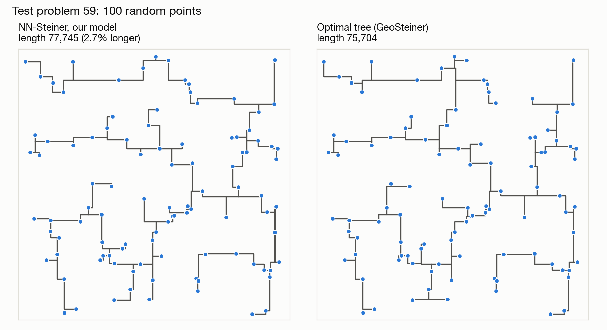
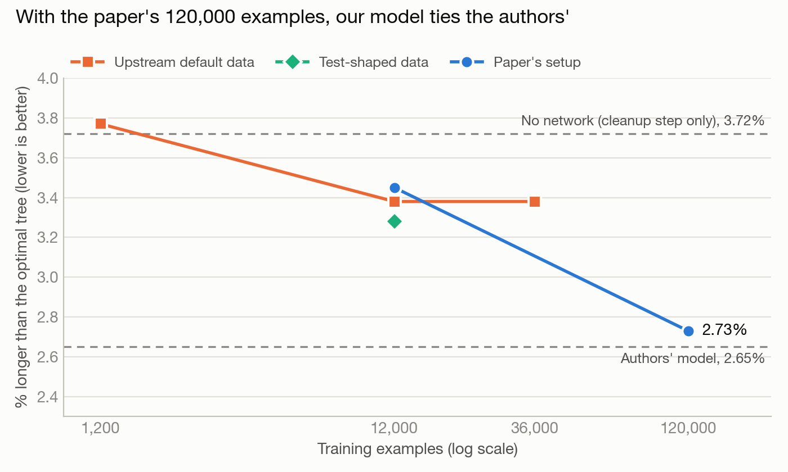

# nn-steiner-rsmt

We reproduce and extend **NN-Steiner** (Kahng et al., AAAI 2024), which mixes a neural network with a classic algorithm to solve the Rectilinear Steiner Minimum Tree problem: connect a set of points using only horizontal and vertical wires, with as little total wire as possible. It comes up all the time in chip design.

The model code is the authors' ([ABKGroup/NN-Steiner](https://github.com/ABKGroup/NN-Steiner)), and our setup script downloads it at a pinned commit. This repo holds everything around it: fixes to their code, configs, experiments and results.



## Results

The score is how much longer a tree is than the optimal one from GeoSteiner (an exact solver), averaged over the authors' 100 test problems of 100 random points each. Lower is better.



| Model | Training examples | % longer than optimal |
|---|---|---|
| Authors' model, published | 120,000 | 2.65 |
| Authors' model, run by us | 120,000 | 2.65 |
| Ours, upstream default data | 1,200 | 3.77 |
| Ours, upstream default data | 12,000 | 3.38 |
| Ours, upstream default data | 36,000 | 3.38 |
| Ours, test-shaped data | 12,000 | 3.28 |
| Ours, paper's setup | 12,000 | 3.45 |
| **Ours, paper's setup** | **120,000** | **2.73** |
| No network (cleanup step only) | | 3.72 |
| FLUTE (standard heuristic) | | 1.25 |

- **Upstream default data:** the settings from the authors' example. All points land in one corner of the quadtree's box, so the trees are much deeper than in the test problems.
- **Test-shaped data:** points spread over the whole box, like the test problems.
- **Paper's setup:** how the paper says it trained: one shared quadtree shape, batches of 500, no early stopping.

FLUTE is still better at 100 points. The paper's claim is that NN-Steiner wins on bigger problems (500+ points), which we're testing next.

## What we found

- The authors' code, as published, doesn't reproduce their paper. Their last commit left a cleanup step (`refine_leaves`) commented out, which turns the code into one of their ablations. Their own model scores 6.87% that way. With the line restored (patch 0004) it scores 2.648%, vs 2.646% in the paper.
- The default seeds leaked validation data into training: 96 training examples were near-copies of the validation examples. We moved the training seeds far away.
- The number of training examples was the gap. On the default data, going from 12,000 to 36,000 examples changed nothing. Changing the data's shape or the portal threshold only helped a little. With the paper's setup and its full 120,000 examples, our model ties the authors': +0.08 ± 0.09 points, and ours is shorter on 52 of the 100 problems. That took about 22 hours on a Mac, roughly 1/36 of the paper's training.
- With too few examples, long training just memorizes. On 12,000 examples the paper's setup reached training F1 0.98 while validation F1 fell, and the trees got worse. With 120,000, training F1 only reached 0.76, and the trees improved until about epoch 40 and then held steady.

Every experiment, with run folders and error bars, is in [docs/Findings.md](docs/Findings.md).

## Layout

```
configs/        our run settings; each inherits the authors' conf/config.yaml and lists only what changes
scripts/        setup.sh, arora.sh (runs the authors' code with a config), and helpers
notebooks/      colab.ipynb: the Colab entry point
third_party/
  patches/      our fixes to the authors' code, applied by setup.sh
  NN-Steiner/   the authors' code (downloaded, not committed)
results/        the figures above; redraw them with scripts/make_figures.py
work/           everything runs generate: data/, points/, models/, outputs/, exp_out/ (not committed)
```

## Quick start

**Colab:** open [notebooks/colab.ipynb](https://colab.research.google.com/github/Ashilman25/nn-steiner-rsmt/blob/main/notebooks/colab.ipynb), choose a GPU runtime, and run the cells in order. `work/` is linked to the shared Drive folder.

**macOS (Apple Silicon):** training and inference run on the Mac's GPU (MPS). Requires [Homebrew](https://brew.sh) and Python 3.10–3.13 (Hydra breaks on 3.14).

```bash
python3.10 -m venv .venv && source .venv/bin/activate
scripts/setup.sh              # build everything (a few minutes the first time)
scripts/smoke_test.sh         # tiny data + a few training epochs, about 1 minute
scripts/get_pretrained.sh     # optional: the authors' model, ~770 MB
scripts/arora.sh pretrained_solve
```

## Running experiments

```bash
scripts/arora.sh <config> [overrides...]
scripts/arora.sh smoke 'flow=[train]' train.epochs=10 train.lr=3e-4
```

- `<config>` is a file in `configs/` (without `.yaml`). Start a new experiment by copying `smoke.yaml`.
- Relative paths in configs resolve from `work/`. The authors' bundled test point sets are under `upstream/points/...`.
- Each run writes its logs, config, TensorBoard events, and checkpoints to `work/outputs/<date>/<time>/`. Trained models are in `train/model/`.
- Quote overrides that contain `[ ]`. Hydra can't parse `=` inside a command-line value, so don't use `=` in file names (e.g. `m15_kb4.pt`, not `m=15_kb=4.pt`).

## Our patches to the authors' code

| Patch | Why |
|---|---|
| `0001-rmst-include-cstddef` | RMST doesn't compile on newer GCC (Colab) without `<cstddef>` |
| `0002-single-device-training` | Upstream training requires 2+ NVIDIA GPUs. With the patch it also runs on 1 GPU (Colab), Apple MPS, or CPU; checkpoints load without CUDA |
| `0003-rmst-64bit-and-clang-fixes` | RMST stored pointers in 32-bit `int`s (unsafe on 64-bit machines), and a missing `<stdlib.h>` broke the clang build |
| `0004-restore-leaf-refinement` | The authors' final commit left a cleanup step (`refine_leaves`) switched off, which is one of their ablations. Turning it back on reproduces their reported results |
| `0005-data-gen-stall-retry` | GeoSteiner (without CPLEX) can get stuck forever on a rare point set, which froze data generation. If no example finishes for 2 minutes, the stuck ones are redone with new points (logged as a warning). All other examples are unchanged |
| `0006-keep-numbered-checkpoints` | Adds `train.keep_every=N` to also save a numbered checkpoint every N epochs, so checkpoints from different points in a long run can be scored and compared |
| `0007-data-gen-level-kb` | The paper's data mode (`data_gen.constraint: level`, one shared quadtree) crashed reading a setting from the wrong place |

GeoSteiner is built without CPLEX (the authors used CPLEX). It still solves exactly, but solve times will differ from the paper.
